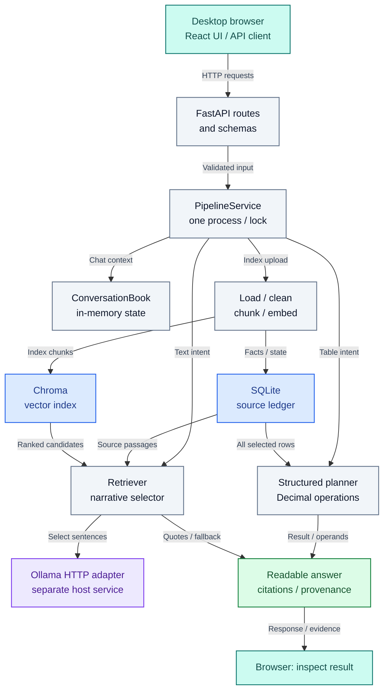

# Document Desk MVP — architecture

Author: **Imitiyaz**. AI assistance: **AI Agent**. [Attribution](AUTHORS.md).

## Runtime components and evidence paths

This application combines a complete source-record ledger for supported table operations with ranked retrieval and bounded narrative extraction. A React workspace calls one FastAPI process. Python parsing, cleaning, chunking, embeddings, persistence and generation are injectable components.

**Figure ARC-01 — Runtime architecture and evidence paths.**

The diagram shows one local API process and its evidence paths. FastAPI validates requests before PipelineService coordinates indexing, conversation context, supported calculations and narrative selection under its workspace lock. ConversationBook is process-local memory, not another service.

Indexing stores original source facts and readiness in SQLite and searchable chunks in Chroma. The structured planner reads every selected source record for Decimal calculations. The narrative selector ranks vector candidates, reads canonical passages and can call the separate Ollama service. Its output is validated source text or a clearly labeled fallback. Both paths return readable results with source evidence to the browser.

The browser is shown at entry and at the response endpoint to avoid a long return loop; both labels refer to the same UI. Arrows from the stores show which source data each answer path consumes. Service arrows identify coordination and model calls; the diagram is an architecture view rather than a chronological request trace. The host-model boundary is explicit. SQLite and Chroma do not share one atomic transaction. See the [browser sequence](docs/journey.md#browser-to-answer-sequence) for message order.

## Boundaries and responsibilities

**Table ARC-T01 — Boundaries and responsibilities.**

| Location | Responsibility |
| --- | --- |
| backend/app/api | Transport schemas, upload budgets, error mapping, orchestration and lifecycle |
| backend/app/loaders | Format dispatch and physical extraction |
| backend/app/cleaning | Normalized views, table/text deduplication and cell semantics |
| backend/app/chunking | Citation-bearing row/prose chunks |
| backend/app/embedding | Lazy SentenceTransformer adapter and embedding contracts |
| backend/app/vectorstore | Chroma adapter, source-scoped persistence and retrieval |
| backend/app/retrieval | Ranked results and cosine-distance conversion |
| backend/app/structured | Source ledger, scope/intent handling, grouping and exact operations |
| backend/app/conversation.py | Bounded sessions, acknowledged request context and pending choices |
| backend/app/generation | Model transport, original-sentence validation and readable presentation |
| frontend/src | Upload/library controls, conversations, evidence tables and confirmation dialogs |
| backend/tests and frontend/e2e | Synthetic regression inputs, injected backends and actual browser workflows |

## Why two evidence paths?

Top-k similarity search ranks fragments; it cannot establish that every operand of a total was retrieved. Supported table operations therefore query the complete selected ledger population. Decimal arithmetic happens in application tools. The answer includes operand identities and source-cell references.

Narrative answers operate over bounded text candidates and may call Ollama to select complete original sentences. Selection validation checks original wording. Literal subject anchors and adjacent-subject windows now reject covered wrong-name substitutions, including a mixed-subject passage. These checks do not prove semantic entailment, arbitrary identity resolution, relevance or exhaustive retrieval. A labeled excerpt fallback is available when the model output fails validation.

## Shared state

Each indexed document has a filename identity, digest, document ID, extraction profile and lifecycle state. Workspace revisions invalidate stale operations. Conversations retain constraints and acknowledged counting choices rather than previous numeric answers; calculations re-read source records.

Current conversations are process-local, normally one hour long, with a maximum of 100 sessions and 20 acknowledged contexts per session. Restarting the API clears conversation state but preserves indexed documents.

## Consistency model

One reentrant service lock serializes operations in one API process. SQLite and Chroma do not share a transaction. Persistent indexing/deleting states and compensating cleanup prevent normal queries from observing incomplete documents and support recovery on startup. They do not provide distributed atomicity or multi-process locking.

Run one worker. Multi-user authorization, background queues, distributed locks and high-availability deployment are not implemented.

## Design constraints

- A selected source filename bounds ordinary UI questions to one document.
- Parser limits reject unsupported/budget-exceeding inputs rather than silently truncating.
- Original upload bytes are hashed and then temporary copies removed; they are not a document archive.
- Inferred Region continuations preserve raw blanks and anchor references.
- Cross-sheet overlapping populations may require an explicit physical-record counting choice.
- A source citation cannot replace independent answer-quality evaluation.

See the [browser-to-answer flow and sequence](docs/journey.md), [pipeline](docs/pipeline.md), [data model](docs/data-model.md), [API sequence](docs/api.md) and [security boundaries](SECURITY.md). The [diagram gallery](docs/diagrams.md) collects all views with context links.

## Reading the runtime diagram

The browser initiates upload, question and lifecycle requests. Routes validate transport shapes, while PipelineService owns one process-local operation lock and coordinates the work. Ingestion produces both the canonical ledger and search vectors. ConversationBook carries acknowledged constraints rather than cached numeric answers. The table engine re-reads all selected records; narrative selection reads bounded original passages and asks the separate Ollama process for sentence choices. The presenter attaches readable values, scope, limitations and provenance to the response.

**Table ARC-T02 — Reading the runtime diagram.**

| Diagram component | Concrete implementation | Relationship and boundary |
| --- | --- | --- |
| React UI / API client | frontend/src/App.tsx and api.ts | Sends actual user choices and acknowledged context; cannot establish backend correctness |
| Routes / schemas | backend/app/api/routes.py and schemas.py | Validate transport and expose OpenAPI; no authentication layer is implied |
| PipelineService / lock | backend/app/api/service.py | Serializes one process and compensates partial writes; not a distributed transaction |
| Ingestion | loaders, cleaning, chunking and embedding packages | Carries physical provenance into both stores; parsing budgets reject unsupported inputs |
| ConversationBook | backend/app/conversation.py | Source identity, current request and pending choices expire with the process/session |
| Structured planner / Decimal | backend/app/structured | Complete population, supported intent and compatible-unit operations |
| Retriever / narrative selector | retrieval and generation packages | Ranked candidates plus canonical text, literal subjects and original-sentence checks |
| SQLite / Chroma | structured/store.py and vectorstore/chroma_client.py | Complementary stores; source readiness/recovery coordinates their lifecycle |
| Ollama adapter | generation/llm_client.py | Separate HTTP service and model licensing; availability/latency independent of API health |
| Readable presentation | generation package and frontend components | Results and evidence remain separate views of the same response; original operands remain inspectable |

Docker adds NGINX in front of the same API and uses named volumes. It does not change calculation semantics, add authentication or make multiple API workers safe. See [container topology](docs/docker.md).
