# Document Desk MVP — ask your documents, check the answer

Author: **Imitiyaz**. AI assistance: **AI Agent**. [Attribution](AUTHORS.md).

**Keep document analysis on your own machine—and check the evidence behind the answer.**

I built Document Desk MVP to ask practical questions about Excel workbooks and PDF documents without requiring a hosted AI service. With the supplied local setup and Ollama running on the same machine, document parsing, embeddings, indexed records, calculations and model inference stay on that machine.

Local processing is only part of the goal. A useful answer also needs the right records, the right scope and a way to see what is missing. Document Desk pairs readable answers with original rows, spreadsheet cells and PDF passages. Supported calculations use exact tools over the complete selected records; narrative questions use a separate local model to select source sentences.

This is a **single-user learning MVP**, with useful working capabilities and explicit limits. It supports bounded questions and follow-ups, document removal, workspace reset and local deployment with or without Docker. It does not claim general reasoning, universal document accuracy or readiness for public multi-user hosting.

**Local processing is not an air-gap guarantee.** Installation and model downloads use external services. A remote Ollama endpoint changes where question context is sent. See [data locality and privacy](docs/privacy.md).

**Try it:** follow the [Windows native guide](docs/setup.md) or [Docker guide](docs/docker.md), upload the supplied synthetic workbook, and verify North's **45,000** against **Q3 Sales / B2**. No private business documents are needed.

Application **0.3.8** · **AGPL-3.0-only** · Local, single-user learning MVP.

[Application preview](#application-preview) · [Get started](#try-a-question-and-check-the-source) · [Capabilities](#what-you-can-do) · [Boundaries](#what-it-does-not-promise) · [All diagrams](#visual-tour) · [Lessons](#lessons-learned) · [What next](#what-next) · [Every file](PROJECT_MAP.md)

## Application preview

The desktop workspace brings the document library, question and source evidence into one view. Read the answer first, then open a citation to inspect the original cells or passages.

**Figure UI-01 — Desktop lookup with original-cell evidence expanded.**

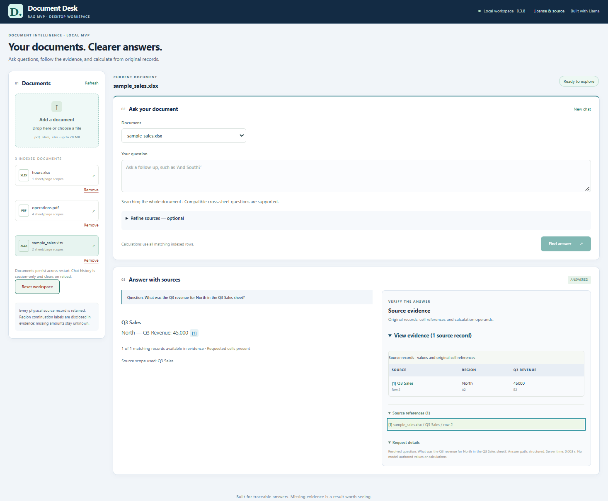

This is an operator-supplied application **0.3.8** screenshot using synthetic documents. It shows the interface and source-cell relationship. The model and embedding configuration was not recorded with this manual capture; the image does not establish real-model performance.

See the [UI walkthrough](docs/ui.md) for the subtotal screen, capture context and instructions to create your own screenshots.

## Start with your task

**Table OVR-T01 — Start with your task.**

| Task | Start here |
| --- | --- |
| Understand every shipped file | [Project map](PROJECT_MAP.md) and [file catalogs](docs/catalog/index.md) |
| Run without Docker on Windows | [Native setup and complete browser smoke test](docs/setup.md) |
| Run the packaged application locally | [Docker Compose deployment](docs/docker.md) |
| Understand the stack and its trade-offs | [Technology stack](docs/technology-stack.md) |
| Follow URL launch through the response | [End-to-end flow, sequence, data flow and swimlanes](docs/journey.md) |
| Understand data flow and calculations | [Architecture](ARCHITECTURE.md), [pipeline](docs/pipeline.md), [data model](docs/data-model.md) |
| Clean outputs or recover document data | [Targeted cleanup](docs/cleanup.md) and [operations/backup](docs/operations.md) |
| Preview the desktop application | [UI walkthrough](docs/ui.md) and [capture guide](docs/screenshots.md) |
| Understand local data handling | [Data locality and privacy](docs/privacy.md) |
| Browse all documentation and diagrams | [Documentation index](docs/index.md) and [all diagrams below](#visual-tour) |
| Test or contribute | [Development](docs/development.md), [testing](docs/testing.md), [contributing](CONTRIBUTING.md) |
| Review release boundaries and license | [Acceptance](docs/acceptance.md), [limitations](docs/limitations.md), [license](LICENSE-NOTICE.md) |

## What you can do

- Upload one `.pdf`, `.xlsx` or `.xlsm` file at a time; select an indexed document and ask whole-document questions.
- Retrieve supported table records with original page/sheet, row and spreadsheet-cell references.
- Calculate supported sums, minimum/maximum, increases and growth through deterministic Decimal tools. Calculations use the complete selected ledger population rather than the top-k search results.
- Request supported region/product/name breakdowns and compatible cross-section calculations; confirm physical-record counting when populations may overlap.
- Continue bounded conversations, clarify a pending request, or start a new chat without deleting documents.
- Inspect missing values, absent records, zeroes, repeated records, formula caches and disclosed Region-continuation anchors.
- Ask narrative questions using a separately installed local Ollama model. The model selects original source sentences; the application validates wording and checks explicit literal subjects.
- Remove an individual document or reset the workspace through separate confirmed actions.

## What it does not promise

- **General language understanding:** the structured planner supports a bounded set of question forms. Arbitrary analytics, fuzzy aliases, complex pronouns and open-ended agent behavior are not implemented.
- **Universal narrative correctness:** literal subject checks reduce wrong-entity substitutions; they do not prove entailment, resolve all references or guarantee a complete answer. Inspect evidence and [known limits](docs/limitations.md).
- **Arbitrary file fidelity:** no OCR for image-only PDFs, no legacy `.xls`, no arbitrary nested/malformed tables, and no execution of spreadsheet macros or recalculation of formulas.
- **Multi-user/cloud readiness:** no login, permissions, tenant isolation, distributed locking, high availability or horizontal API scaling. Run one API worker.
- **Unlimited size or speed:** parser ceilings are protective budgets, not measured capacity guarantees. Narrative latency depends on the installed model/hardware.
- **Permanent chat memory or a file archive:** conversations are process-local; temporary uploads are removed after extraction. Keep original documents in your approved source system.

## How answers are produced

**Figure OVR-01 — How answers are produced.**

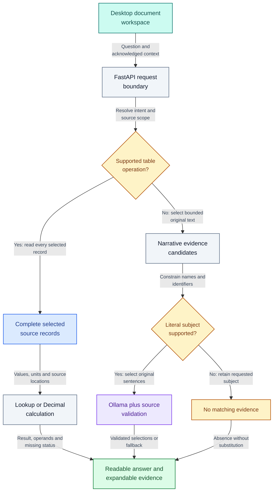

The decision node separates complete table operations from bounded narrative evidence. Ledger/Decimal results carry operands; the narrative subject gate can abstain before Ollama. Both paths preserve answer boundaries rather than implying general reasoning.

The table path supplies exact operands and source identities. The narrative path remains a bounded extraction workflow; neither a fluent answer nor a resolved citation establishes correctness by itself. See the [architecture explanation](ARCHITECTURE.md).

## Try a question and check the source

Follow [setup](docs/setup.md) first. Open **http://127.0.0.1:5173/** for the native development setup, or **http://127.0.0.1:8080/** for Compose. Upload `backend/tests/fixtures/sample_sales.xlsx` and ask:

> What was the Q3 revenue for North in the Q3 Sales sheet?

Expect **45,000**, with `Q3 Sales`, row **2**, cell **B2** in evidence. Then ask **And South?** and expect **38,000**, row **3**, cell **B3**. The guide also checks missing values, a subtotal and an unknown narrative subject.

## Visual tour

Every implemented-system diagram appears on this page. The [answer overview](#how-answers-are-produced) is above; the remaining views follow. Each figure links to its full explanation, component responsibilities and operating boundaries. [The compact diagram index](docs/diagrams.md) is available for direct navigation.

**Table OVR-T02 — Choose a visual reading route.**

| View | Read for |
| --- | --- |
| [Runtime and deployment](#runtime-and-deployment) | API, evidence stores, model boundary and Compose topology |
| [From browser to response](#from-browser-to-response) | URL load, optional upload, question, clarification and evidence inspection |
| [Data, processing and conversations](#data-processing-and-conversations) | Extraction, complete calculation operands, narrative routing and context |
| [Document lifecycle and responsibilities](#document-lifecycle-and-responsibilities) | Source identity, states, removal handoffs and interrupted-write recovery |
| [Security and engineering lifecycle](#security-and-engineering-lifecycle) | Trust boundaries, development checks and human release approval |

### Runtime and deployment

**Figure ARC-01 — Runtime architecture and evidence paths.**

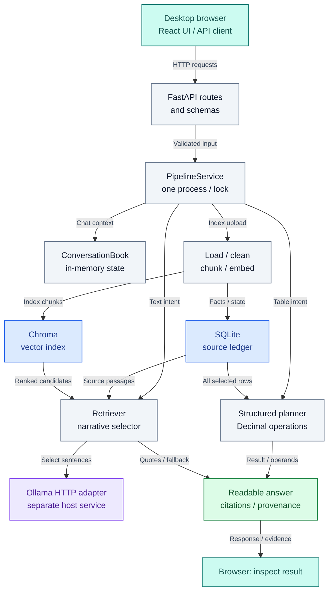

[Architecture: components, boundaries and evidence paths](ARCHITECTURE.md#runtime-components-and-evidence-paths).

**Figure DCK-01 — Container topology and data ownership.**

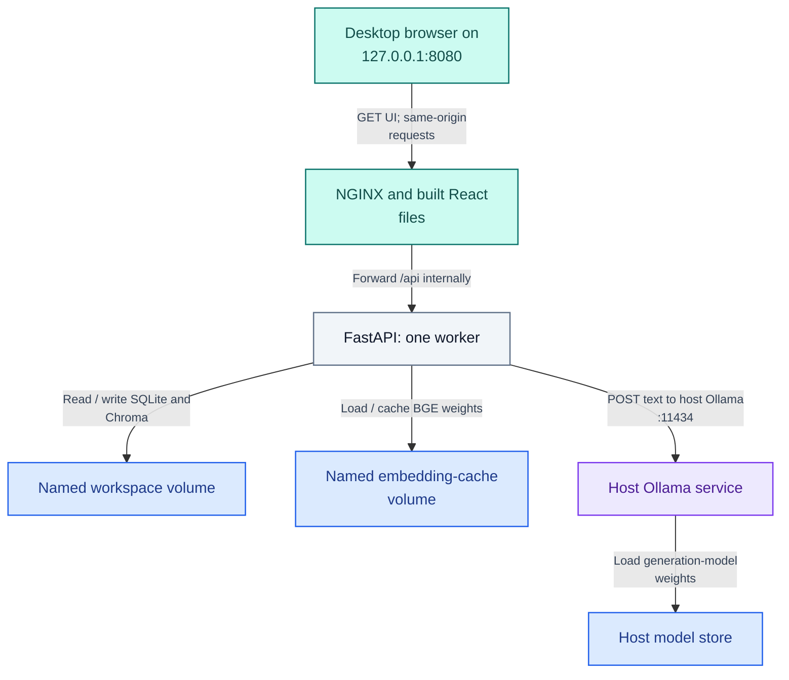

[Read the full explanation](docs/docker.md#container-topology) · [Back to visual routes](#visual-tour)

### From browser to response

**Figure E2E-01 — From application URL to readable result and source inspection.**

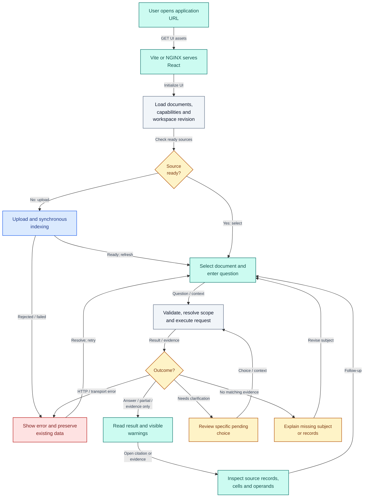

[Read the full explanation](docs/journey.md#browser-to-answer-process-flow) · [Back to visual routes](#visual-tour)

**Figure E2E-02 — URL load, optional indexing and a first or follow-up question.**

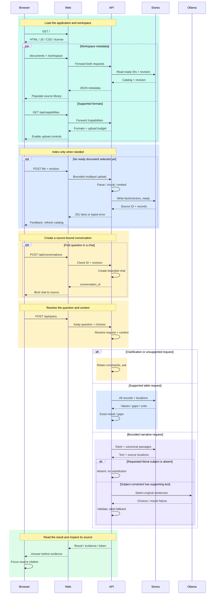

[Read the full explanation](docs/journey.md#browser-to-answer-sequence) · [Back to visual routes](#visual-tour)

### Data, processing and conversations

**Figure FLOW-01 — Evidence data from upload bytes to an inspectable answer.**

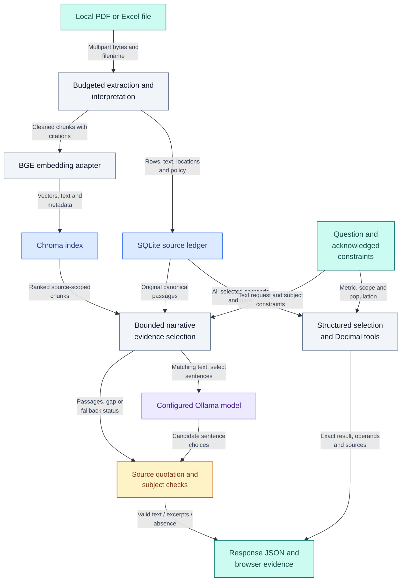

[Read the full explanation](docs/journey.md#data-flow-and-retention) · [Back to visual routes](#visual-tour)

**Figure PIPE-01 — Ingestion from bounded upload to ready document.**

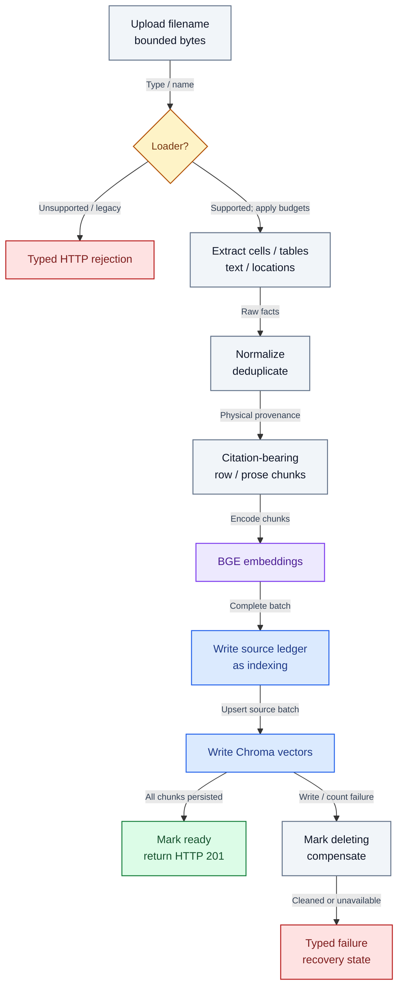

[Read the full explanation](docs/pipeline.md#ingestion) · [Back to visual routes](#visual-tour)

**Figure PIPE-02 — Query routing, clarification and honest fallback.**

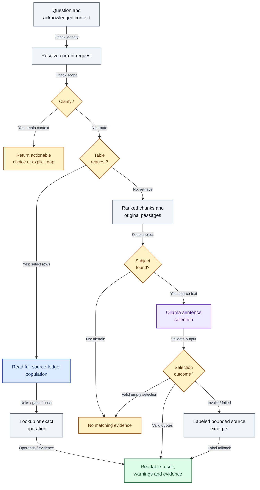

[Read the full explanation](docs/pipeline.md#query-routing) · [Back to visual routes](#visual-tour)

**Figure API-01 — Conversations.**

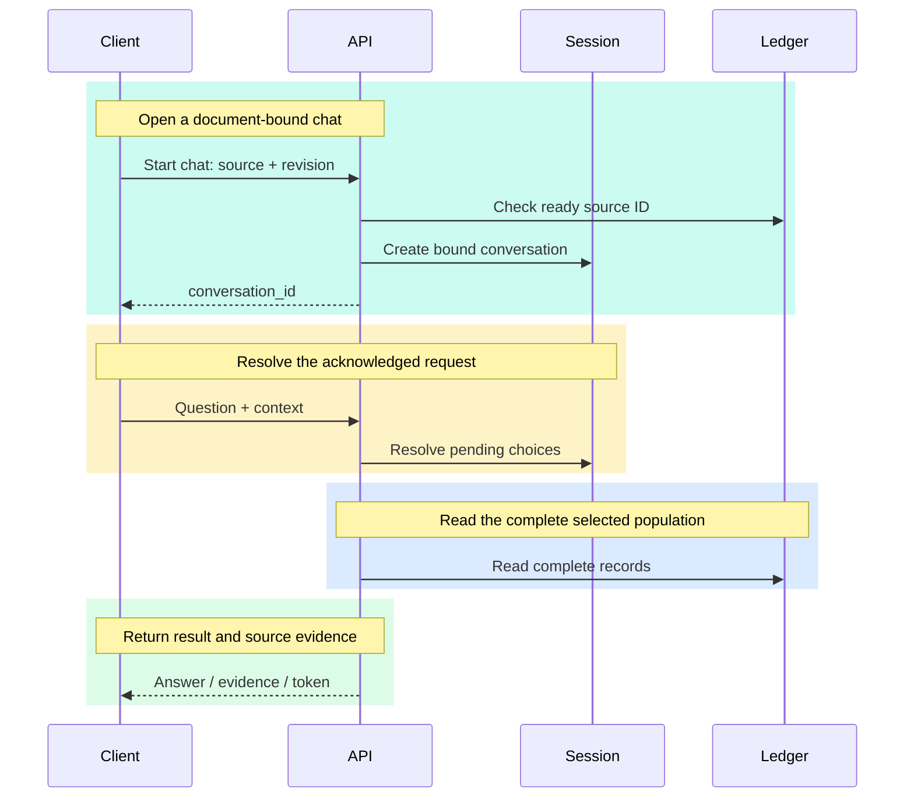

[Read the full explanation](docs/api.md#conversations) · [Back to visual routes](#visual-tour)

### Document lifecycle and responsibilities

**Figure DATA-01 — Source ledger.**

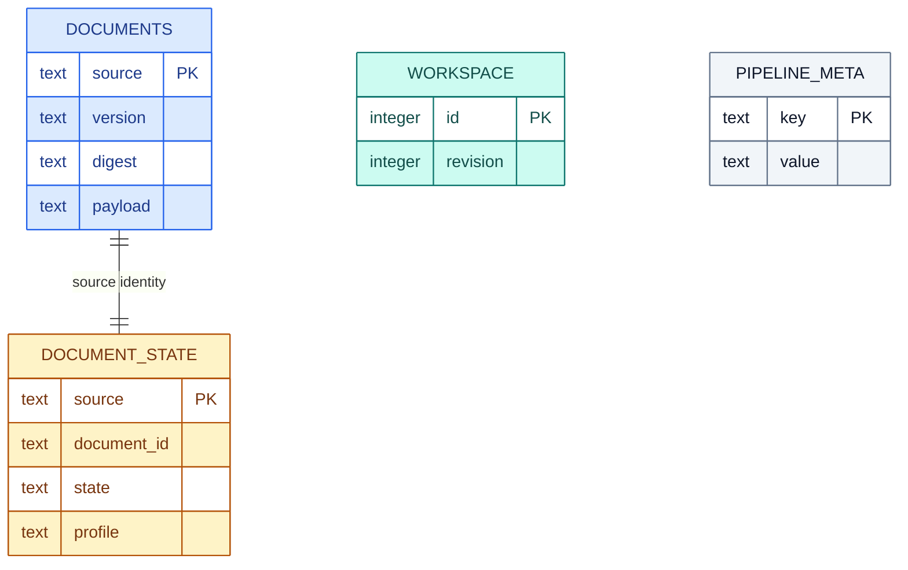

[Read the full explanation](docs/data-model.md#source-ledger) · [Back to visual routes](#visual-tour)

**Figure DATA-02 — Document state.**

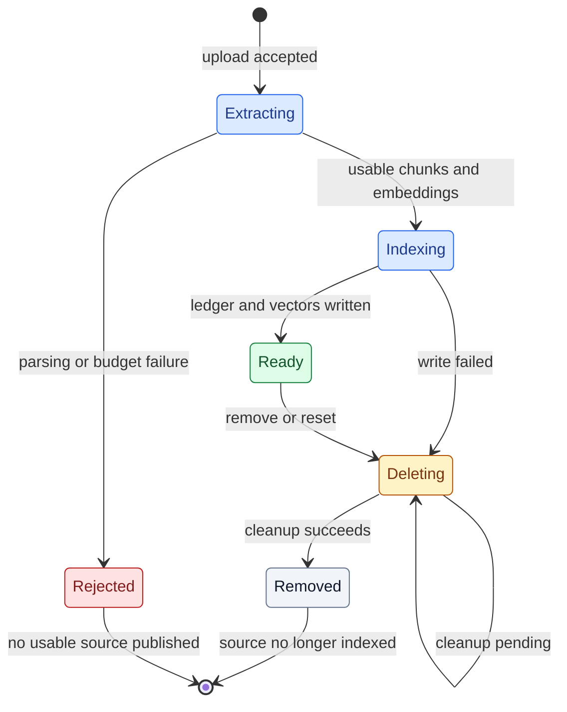

[Read the full explanation](docs/data-model.md#document-state) · [Back to visual routes](#visual-tour)

**Figure SWIM-01 — Browser, API and persistence responsibilities across a document lifecycle.**

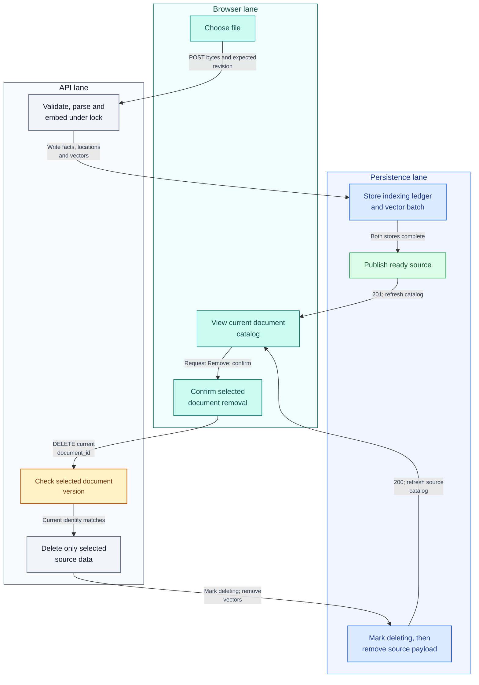

[Read the full explanation](docs/journey.md#swimlane-responsibilities-for-indexing-and-removal) · [Back to visual routes](#visual-tour)

**Figure OPS-01 — Startup reconciliation of incomplete document writes.**

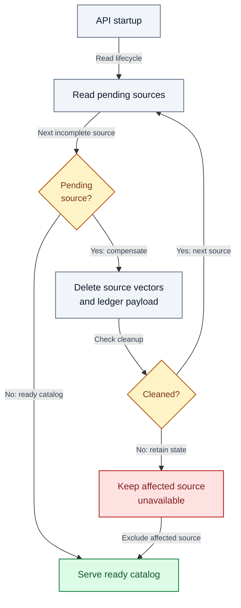

[Read the full explanation](docs/operations.md#interrupted-indexingdeletion) · [Back to visual routes](#visual-tour)

### Security and engineering lifecycle

**Figure SEC-01 — Local trust and data-transfer boundaries.**

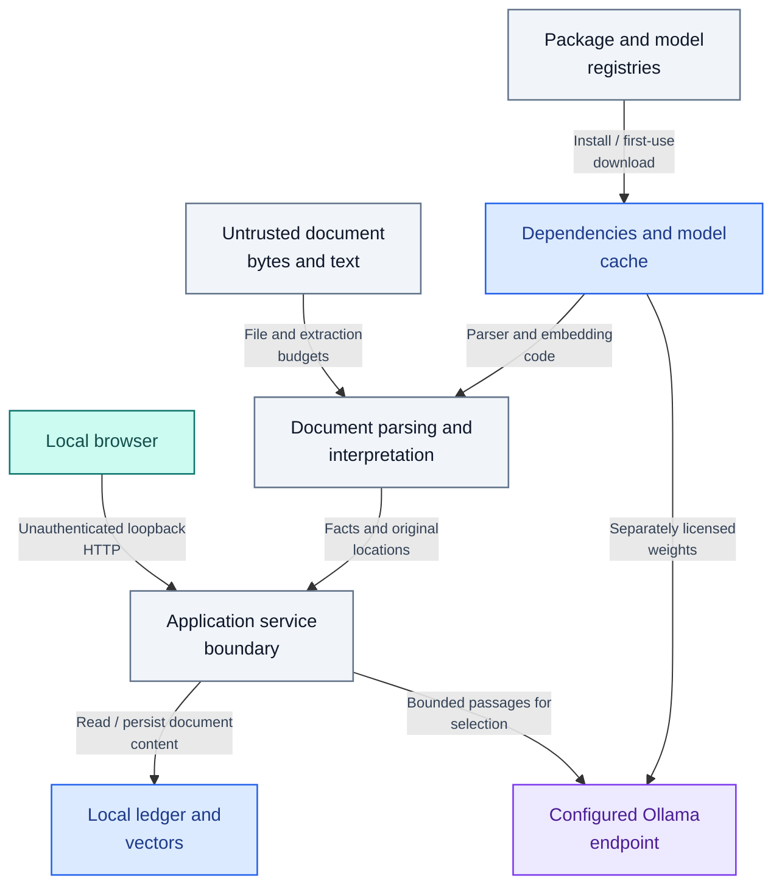

[Read the full explanation](SECURITY.md#supported-boundary) · [Back to visual routes](#visual-tour)

**Figure LIFE-01 — Engineering decision gates and release ownership.**

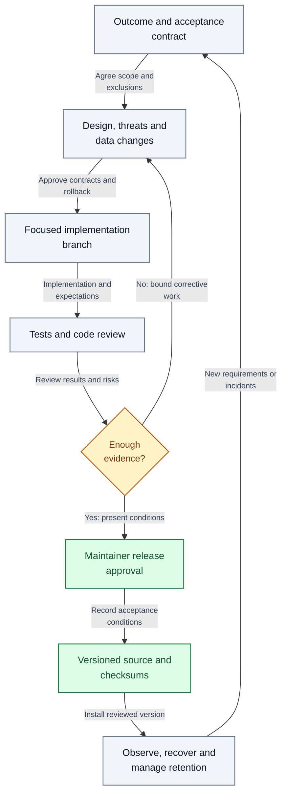

[Read the full explanation](docs/development.md#roles-and-decision-gates) · [Back to visual routes](#visual-tour)

**Figure LIFE-02 — Implemented CI checks and manual release decision.**

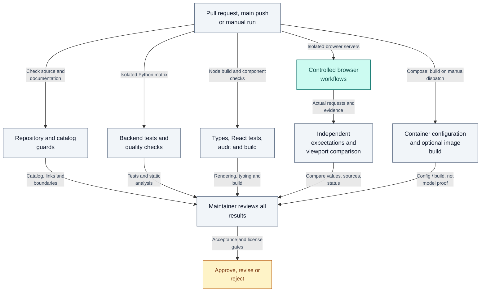

[Read the full explanation](docs/development.md#ci-implemented-in-this-repository) · [Back to visual routes](#visual-tour)

## Lessons learned

- **Plan the outcome before generating code.** Define supported questions, exclusions and expected source facts; a narrow contract makes it easier to review a change.
- **Budget for AI-assisted development.** Allow for monthly tool subscriptions and usage even when learning, and remember that mistakes consume time as well as tokens. Requirements, testing, integration and documentation still need attention.
- **Keep decisions and handovers portable.** Clear contracts, reproducible fixtures and written evidence helped me continue the work across Anthropic Claude and OpenAI ChatGPT/Codex.
- **Check the population, not only the arithmetic.** A correct sum over omitted or misidentified rows is still the wrong answer. A citation can also point to the wrong subject.
- **Test the conversation and the tools that test it.** Follow-ups, page changes, missing values, failed model calls and browser controls need independent expectations.
- **Make recovery part of the application.** A usable local workspace needs deliberate deletion, persistence, backup and restore, as well as a successful first upload.

These are lessons from building this MVP, not claims that every failure class has been eliminated. See [verification scope](docs/validation.md) and [known limitations](docs/limitations.md).

## What next

This MVP gives me a foundation for a broader **Document Intelligence Workspace**: a place to explore documents conversationally, inspect their evidence and perform supported analysis while keeping local processing a central design goal.

That larger workspace is a direction for future work, not an implemented capability claim. Better intent understanding, representative document evaluation, measured resource limits and richer workflows need their own design and evidence.

I would welcome like-minded developers who want to improve document extraction, evaluation, accessibility, reproducibility or the local user experience. Start with [Contributing](CONTRIBUTING.md), propose a bounded problem and bring a synthetic example with an independently checked answer. The application is AGPL-3.0-only; model and dependency terms remain separate.

## Release scope and verification

This first public-source release packages application **0.3.8**. Controlled regression, Windows browser, local Docker recovery and focused actual-model checks cover the documented cases. The [verification record](docs/validation.md) distinguishes those layers; it is not an independent certification.

Narrative latency, representative business-document coverage, reliable memory attribution and a measured capacity envelope remain limitations. Read the [supported scope](docs/acceptance.md) before adopting a new workload.

## License and attribution

Copyright © 2026 **Imitiyaz**, author and project owner. AI development and verification support is credited in [Authors and attribution](AUTHORS.md). The application is licensed under [GNU AGPL v3 only](LICENSE); commercial use is permitted under its conditions. Read [source availability](LICENSE-NOTICE.md) and [third-party notices](THIRD_PARTY_NOTICES.md). Models and dependencies retain their own licenses. Built with Llama when using the configured Llama 3.1 model.
