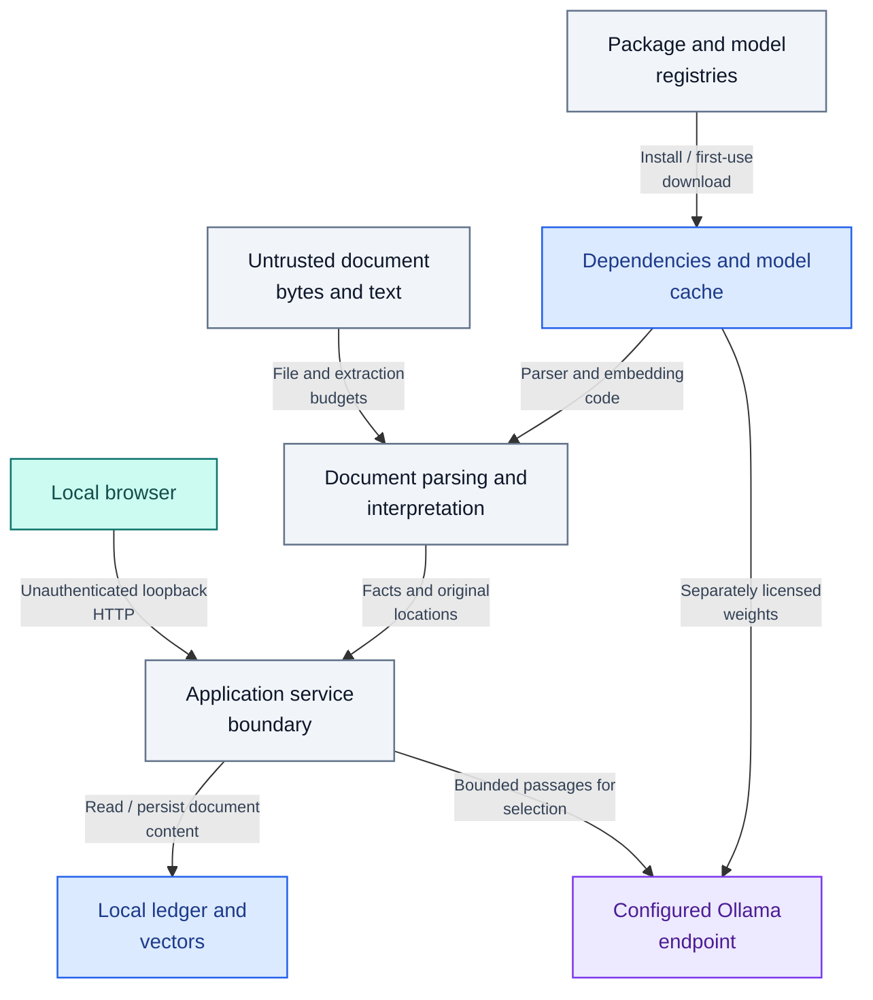

# Security and privacy

Author: **Imitiyaz**. AI assistance: **AI Agent**. [Attribution](AUTHORS.md).

## Supported boundary

This is a local, single-user application. The API has **no authentication, authorization, tenant isolation, TLS termination or rate limiting**. Run the backend and frontend on loopback. CORS and document/revision tokens are not access controls.

A public source repository does not make the running service suitable for public network exposure.

**Figure SEC-01 — Local trust and data-transfer boundaries.**

Untrusted file bytes enter parser budgets and document text remains evidence rather than trusted instructions. The unauthenticated local browser/API boundary must stay isolated. Persistent stores and the host model service are separate data/availability boundaries; none of these edges implements tenant authorization.

## Existing controls and gaps

**Table SEC-T01 — Existing controls and gaps.**

| Threat / failure | Existing measure | Remaining boundary |
| --- | --- | --- |
| Path traversal / oversized uploads | Filename validation and byte/extraction limits | Parser defects and hostile documents still require isolation |
| Spreadsheet formula/macro execution | Source extraction without execution | Cached values can be stale; layout interpretation can be wrong |
| Partial indexing/deletion | Lock, persistent lifecycle state and cleanup | Single process only; two stores are not atomic |
| Stale document/context mutation | Document IDs and workspace revisions | No user identity or permission check |
| Indirect prompt injection | Evidence-oriented prompts and exact quotation checks | Not a complete injection defense or semantic verifier |
| Unsupported narrative facts | Original-source validation, literal-subject constraint and honest fallback | Not general entailment or alias resolution; correct quotations still need relevant source support |
| SQL injection through model text | Parameterized ledger operations; no arbitrary model SQL | Other parser/logic flaws remain possible |
| Data leakage | Local defaults; transient upload staging | Extracted content persists; logs/model endpoints may receive sensitive information |

## Operating practices

- Process only documents you are authorized to use. Keep sensitive workloads on approved machines.
- Inspect `OLLAMA_BASE_URL` before use. Remote settings transfer selected source content.
- Protect workspace directories and backups with OS access controls and appropriate encryption.
- Treat logs and test/browser artifacts as sensitive: questions, filenames, answers, local paths and excerpts can appear.
- Pin and review dependency updates. Opt-out flags are not proof of no egress.
- Do not run the test-only browser server as the deployment entrypoint.
- Keep secrets, actual documents, model weights, environments and indexes outside source control.
- Restrict system/network access when parsing adversarial files. Parser budgets are not an OS sandbox.

Deletion removes managed application records, not all physical traces, external backups or model caches. See [retention and recovery](docs/operations.md).

## Reporting

Use the repository's **Security → Report a vulnerability** feature when enabled. If unavailable, use a maintainer's published private contact channel. Do not put credentials, confidential documents or exploit-sensitive details in a public issue.

Include the affected version, minimal synthetic reproduction, impact and relevant sanitized logs. Do not test against systems or data without permission.

## Reference guidance

See [OWASP prompt injection](https://genai.owasp.org/llmrisk/llm01-prompt-injection/), [OWASP excessive agency](https://genai.owasp.org/llmrisk/llm062025-excessive-agency/) and [NIST SSDF](https://csrc.nist.gov/pubs/sp/800/218/final). These inform review; this project claims no security certification or framework conformance.
