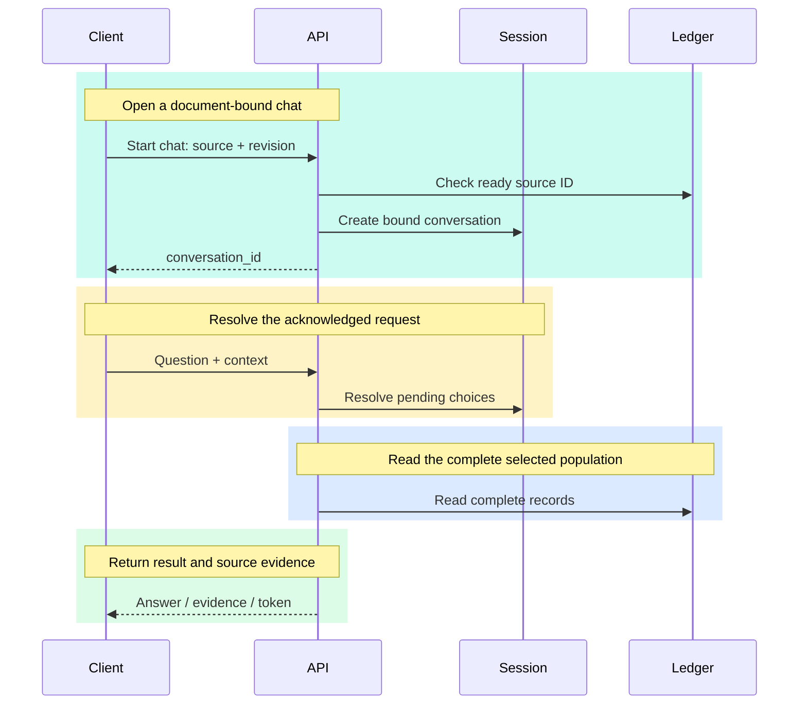

# HTTP API

Author: **Imitiyaz**. AI assistance: **AI Agent**. [Attribution](../AUTHORS.md).

Base URL for local use: `http://127.0.0.1:8000`. Interactive schema: `/docs`. Machine schema: `/openapi.json` and the [checked-in snapshot](openapi.json).

A [portable Postman collection](../postman/RAG_MVP.postman_collection.json) includes non-destructive upload/query/conversation examples.

The API is unauthenticated. Document IDs and workspace revisions prevent stale operations; they are not access credentials.

## Endpoints


**Table API-T01 — Endpoints.**

| Method / path | Purpose | Normal success |
| --- | --- | --- |
| GET /health | Process liveness | 200 |
| GET /ready | Pipeline startup completed | 200 |
| GET /capabilities | Registered extensions and upload limit | 200 |
| GET /documents | Source catalog, IDs, states, revisions and schema choices | 200 |
| POST /documents | Multipart upload and synchronous indexing | 201 |
| DELETE /documents/{source_file} | Remove a selected document version | 200 |
| GET /workspace | Current persistent workspace revision | 200 |
| DELETE /workspace?revision=N | Reset managed documents with stale-generation protection | 200 |
| POST /conversations | Start a conversation bound to one ready document ID | 200 |
| DELETE /conversations/{conversation_id} | Forget that chat's request context | 200 |
| POST /query | Answer or return a domain-level gap/clarification | 200 |

## Upload and first query

From the repository root in PowerShell, with the API running:

```powershell
curl.exe --fail-with-body -sS -X POST 'http://127.0.0.1:8000/documents' -F 'file=@backend/tests/fixtures/sample_sales.xlsx'
$documents = Invoke-RestMethod 'http://127.0.0.1:8000/documents'
$document = @($documents) | Where-Object { $_.source_file -eq 'sample_sales.xlsx' }
if (-not $document) { throw 'Expected indexed sample document.' }

$request = @{
    question = 'What was the Q3 revenue for North in the Q3 Sales sheet?'
    source_file = $document.source_file
    document_id = $document.document_id
    workspace_revision = $document.workspace_revision
}
Invoke-RestMethod -Method Post -Uri 'http://127.0.0.1:8000/query' -ContentType 'application/json' -Body ($request | ConvertTo-Json -Depth 8)
```

Use `X-Workspace-Revision` on uploads when protecting a previously read workspace generation. Same-name uploads return 409; existing indexed data is not overwritten.

## Conversations

```powershell
$chat = Invoke-RestMethod -Method Post -Uri 'http://127.0.0.1:8000/conversations' -ContentType 'application/json' -Body (@{
    source_file = $document.source_file
    document_id = $document.document_id
    workspace_revision = $document.workspace_revision
} | ConvertTo-Json)

$request.conversation_id = $chat.conversation_id
$answer = Invoke-RestMethod -Method Post -Uri 'http://127.0.0.1:8000/query' -ContentType 'application/json' -Body ($request | ConvertTo-Json -Depth 8)
$request.context_token = $answer.context_token
$request.question = 'And South?'
Invoke-RestMethod -Method Post -Uri 'http://127.0.0.1:8000/query' -ContentType 'application/json' -Body ($request | ConvertTo-Json -Depth 8)
```

For every subsequent turn, acknowledge the most recently accepted response's `context_token`. Omitted and explicit-null tokens have different compatibility semantics. Do not silently replay a confirmation into a different source, metric or calculation population.

**Figure API-01 — Conversations.**



The client opens a conversation against current source identity/revision, then sends the exact question and acknowledged context. The API resolves the request and re-reads source records. Only the accepted response advances client context; cancellation or stale source identity must not silently carry forward.


## Request controls

`question` is required (1–4000 characters, non-whitespace). `source_file` selects one document. `top_k` affects ranked retrieval, not completeness of structured totals. `min_score` is a similarity threshold, not a calibrated probability.

Optional structured controls include `fields`, equality `filters`, `operation`, `sheet_or_page`, `source_scopes`, `record_scope`, `aggregation_basis`, `group_field`, `entity_groups` and `breakdown`. See exact enums/limits in OpenAPI. `page`/`page_size` paginate displayed evidence, not calculation populations.

Use ordinary UI-equivalent requests when evaluating natural-language behavior. Explicit controls are useful API capabilities but must not mask conversational failures in acceptance tests.

## Response interpretation

HTTP 200 can contain `answered`, `incomplete`, `no_evidence` or `clarification_required`. Check the domain status, not just HTTP success.

Important fields include `resolved_question`, `execution_path`, `answer_items`, `records`, `coverage`, `calculation`, `grouped_results`, `warnings`, `citations`, `unresolved_citation_numbers` and timing/model metadata.

`model: null` on a structured answer means no model authored its values. A non-null model name does not establish answer correctness. Resolved citation numbers establish references, not entailment.

## Errors

Errors contain `status_code`, `code`, `message` and `details`.


**Table API-T02 — Errors.**

| HTTP status | Typical cause |
| --- | --- |
| 400 | Invalid upload filename/request context |
| 404 | Selected document not indexed |
| 409 | Duplicate filename, stale identity/revision or reindex requirement |
| 413 | Upload/body/extraction budget exceeded |
| 415 | Unsupported type or legacy XLS |
| 422 | Schema validation, corrupt/unusable document or unsupported layout |
| 500 | Unexpected processing or persistence failure |
| 502 / 503 | Model generation/availability failure on applicable paths |

Narrative selection can return a labeled fallback instead of surfacing a model error. Consult the response path/warnings. Error-code mappings and exact responses are defined in `app/api/errors.py`.

For deletion, send the current `document_id` query parameter. For workspace reset, send the current `revision`. Obtain fresh values from the catalog/workspace after mutations.
