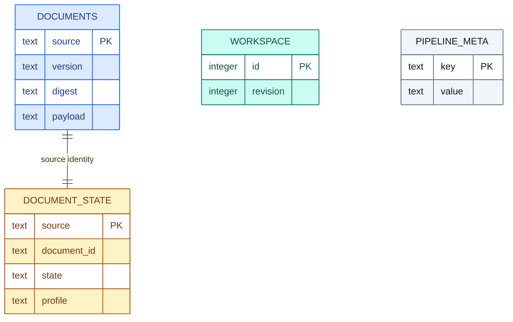
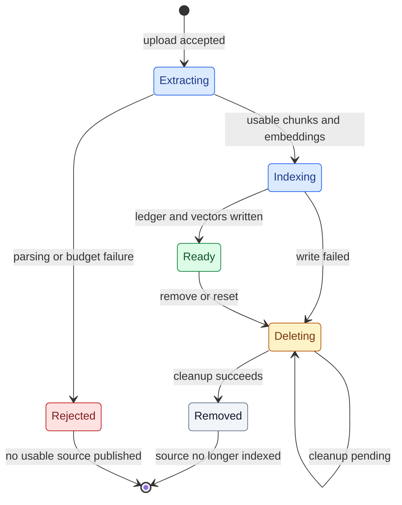

# Data, identity and lifecycle

Author: **Imitiyaz**. AI assistance: **AI Agent**. [Attribution](../AUTHORS.md).

## Source ledger

`RecordStore` persists documents in SQLite. Each source payload contains extracted rows/text, warnings, formats and origin metadata. `original` upload bytes are used to compute the digest and are not stored as an original-file archive.

**Figure DATA-01 — Source ledger.**

DOCUMENTS stores the source payload and compatibility metadata. DOCUMENT_STATE tracks the source identity/readiness used by lifecycle and conversations. WORKSPACE holds a revision; PIPELINE_META holds local index/profile metadata. The relationship is logical and does not imply distributed foreign-key enforcement.

The diagram shows logical source association; it does not imply a cross-store foreign-key transaction. `WORKSPACE` and `PIPELINE_META` are singleton/global metadata for this local ledger.

**Table DATA-T01 — Source ledger.**

| Identity | Meaning |
| --- | --- |
| source_file | Filename used to select an indexed document; duplicates rejected |
| document_id | Version identity checked by conversations/removal |
| digest | SHA-256 of original upload bytes |
| version / profile | Extraction and interpretation policy compatibility |
| workspace revision | Monotonically changed generation used to reject stale mutations/context |
| citation number | Answer-local evidence association |

## Row evidence

Rows carry `values` plus `raw_values`, source coordinates, merged fields, cell formats and formula state. API records expose values and physical cell references; continued labels also expose original blank and anchor provenance.

Missing, empty, zero and absent entities are different states. The Region continuation policy applies under documented adjacency/measure conditions to supported workbooks. Its output is an interpretation view; raw blanks remain available. This policy is domain-specific and must not be generalized to arbitrary fields without explicit design and tests.

Decimal operations use the selected records and compatible units. Cached spreadsheet formula values may be present; the application does not recalculate formulas and cannot establish cache freshness.

## Document state

**Figure DATA-02 — Document state.**

Upload/extraction phases either reject safely or proceed to persistent indexing. Ready documents may be deleted; failed writes and removals remain deleting until reconciliation succeeds. Restart clears conversations but preserves the persisted lifecycle state.

`Extracting` and `Rejected` illustrate request phases; persistent state records use states such as indexing, ready and deleting. Catalog entries can also identify incompatible legacy vectors as requiring reindexing.

On startup, pending cleanup is retried before those documents can become usable. A cleanup failure remains visible and unavailable. This is compensation across SQLite/Chroma, not one atomic transaction.

## Retention

Temporary upload files are removed after processing. Extracted text/cell data and embeddings persist in the workspace. Conversations are bounded in-memory state and are lost on restart. Browser UI state is separate from backend persistence.

Back up both stores while the API is stopped. Test restore in a separate directory. Removing a document does not revoke copies in external backups, logs or exported results; operators must manage those retention domains separately.
