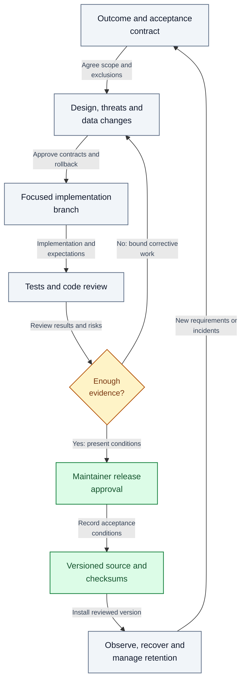
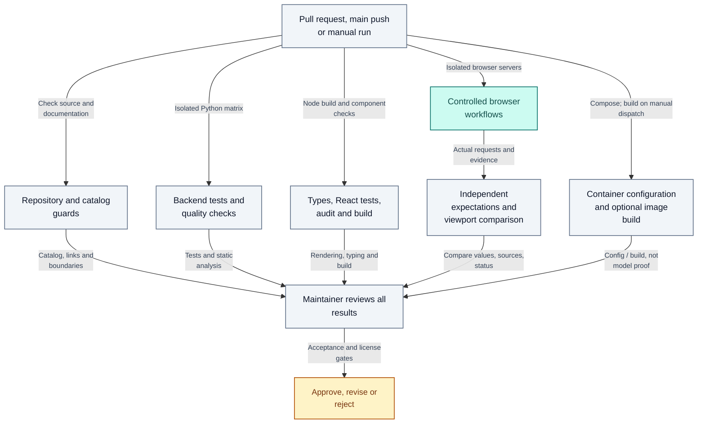

# Development and delivery lifecycle

Author: **Imitiyaz**. AI assistance: **AI Agent**. [Attribution](../AUTHORS.md).

This guide defines the contribution/release workflow for this application. It is a practical engineering process, not a claim of TOGAF, ISO, NIST or MITRE certification.

## Roles and decision gates

One person can hold several roles, but each decision still needs an explicit owner.

**Table LIFE-T01 — Roles and decision gates.**

| Gate | Owner | Required evidence |
| --- | --- | --- |
| Define change | Maintainer / requester | User outcome, supported document assumptions, acceptance examples and exclusions |
| Design | Implementer + reviewer | Affected contracts, data/security implications, compatibility and rollback approach |
| Implement | Contributor | Focused branch, readable changes, tests and documentation |
| Verify | Reviewer | Independent expected facts, automated results and identified test substitutions |
| Approve release | Maintainer | Remaining limitations, dependency/license review, platform/model evidence and rollback readiness |
| Operate / retire | Operator | Backup/restore, monitoring, incident handling and data-retention disposition |

**Figure LIFE-01 — Engineering decision gates and release ownership.**

A requirement becomes a reviewed design and focused change. Independent verification gates release approval; insufficient evidence returns to design. Operation, retention and recovery feed the next requirement instead of treating deployment as the end of engineering.

## Change discipline

Record a reproducing request, source facts and expected behavior before changing a parser, scope resolver or calculation. Cover the class of failure using varied names/layouts/wording, rather than adding fixture-specific terms.

Separate raw source facts, interpretation rules, derived results and presentation. Review defaults and failure paths as carefully as successful examples. A “safe” refusal is not a useful answer to an answerable question.

Keep architecture decisions short: context, decision, alternatives, consequences and verification. Public records should explain enduring engineering choices rather than contain private conversations, host paths or raw diagnostic transcripts.

## CI implemented in this repository

The workflow in `.github/workflows/ci.yml` runs on pull requests, pushes to main and manual dispatch. It uses read-only repository permissions, commit-pinned actions, no deployment credentials and no automatic release/publish step.

**Figure LIFE-02 — Implemented CI checks and manual release decision.**

Repository, backend, frontend, controlled browser and Compose-configuration checks run independently. Image builds run only on manual dispatch; that CI job does not establish host-model or target-runtime behavior. Comparison expectations complement browser success. A maintainer reviews results before a release decision; CI has no authority to publish or deploy automatically.

GitHub branch protection, required checks, private vulnerability reporting and secret-scanning settings are repository settings; source files cannot enable them. Configure them separately when operating a hosted repository.

## Continuous delivery boundaries

CI validates changes. Continuous delivery would additionally prepare reviewed release artifacts and a deployment-ready package. Continuous deployment would automatically install them into an environment. This repository does not implement automatic deployment, signing/attestation or complete environment promotion.

Do not add write permissions, production secrets, auto-merge or `pull_request_target` execution of untrusted code without a specific reviewed need. Review action/dependency update PRs; do not treat dependency automation as an approval mechanism.

## Release evidence

Before tagging an application release, record:

- Source revision and complete runtime/tool dependency resolution.
- Schema, extraction-policy and model/configuration versions.
- Synthetic and representative-document results, including unanswerable/unknown-entity cases.
- Real-model, storage and target-platform evidence separately from fake-backend tests.
- Visual/keyboard checks and operating limits measured on the target hardware.
- Security/license decisions, open issues and an exercised rollback/restore procedure.

Retain sensitive/raw evidence in an access-controlled system. Publish only sanitized summaries. Never republish a trace containing source documents or credentials merely because a test passed.

## Traceability

Link each requirement to its design decision, implementing change, test/reference facts, observed result and disposition. Track correctness/security blockers separately from improvements. A high coverage percentage or a resolved citation marker alone cannot close a correctness issue.

Retirement includes stopping services, retaining/revoking access as appropriate, disposing of indexes/backups/logs according to policy and documenting which user originals remain outside application control.
