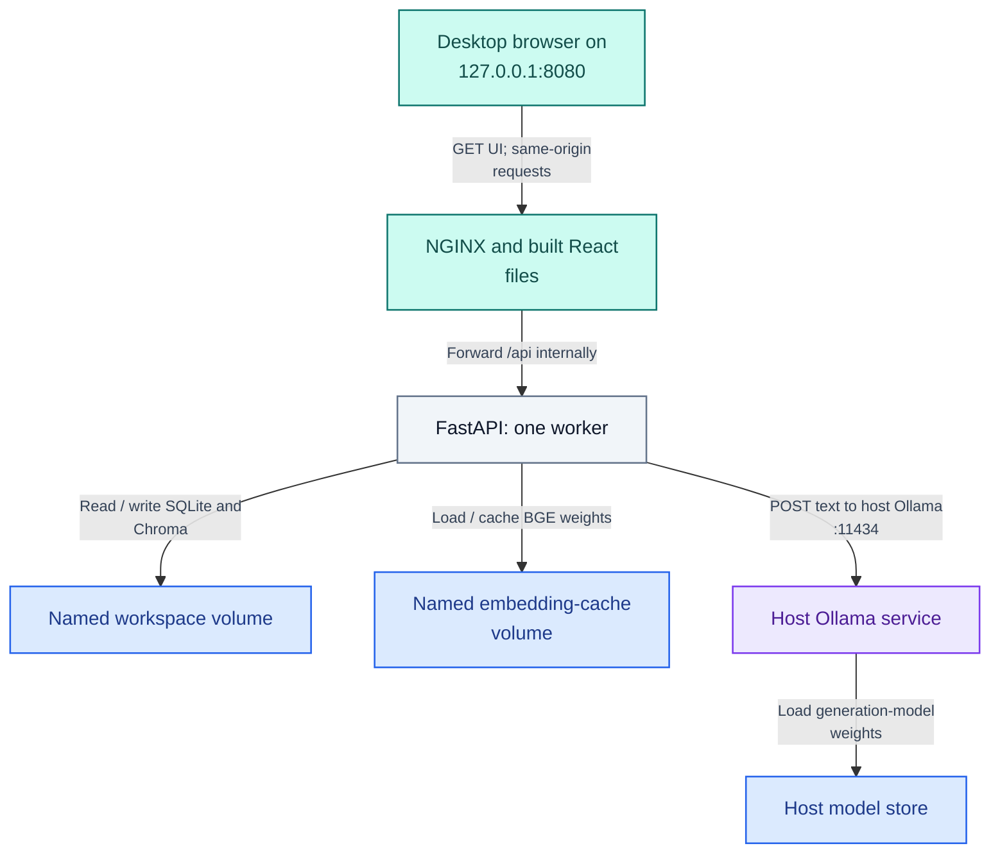

# Docker Compose — install, verify, preserve and recover a local workspace

Author: **Imitiyaz**. AI assistance: **AI Agent**. [Attribution](../AUTHORS.md).

## Deployment scope and evidence

This route serves the built React application through NGINX, with one FastAPI worker and separate named volumes for document data and the BGE model cache. **Ollama runs on your host**, not inside Compose. The source archive contains no prebuilt images or model weights. A native environment/index is not mounted into these containers.

Windows Docker Desktop build, host-model connectivity, persistence, isolated restore and unavailable-model behavior were verified for this runtime. See [validation](validation.md) for exact evidence and limitations. Your own clean installation still needs the steps below. Compose improves reproducibility; it does not supply multi-user authorization, horizontal scaling or production certification.

## Container topology

**Figure DCK-01 — Container topology and data ownership.**



Only the frontend is published to loopback; backend port 8000 remains internal. NGINX forwards API traffic to the backend service. The workspace volume keeps the ledger and vectors together; the embedding cache can survive container recreation. Host Ollama and its weights are a separate dependency and retention domain. A response follows the same proxy route back; this topology figure labels responsibilities rather than depicting every response packet. See the [complete browser sequence](journey.md#browser-to-answer-sequence).

## 1. Select the actual source folder and check prerequisites

Install Docker Desktop with its WSL2/Linux-container prerequisites, start it and wait for the Linux engine. Docker Desktop has separate usage/subscription terms. Install/start Ollama and, if absent, pull `llama3.1:8b-instruct-q4_K_M` as described in [native setup Step 4](setup.md#4-start-ollama-and-check-the-installed-model).

In PowerShell run this complete block. Paste the full path to the extracted folder **containing `compose.yaml`**, without surrounding quotes. Keep this terminal open; later commands use its `$deskRoot`, `$deskCompose`, `$deskProject` and `DESK_PORT` settings.

```powershell
Set-Location -LiteralPath (Read-Host 'Full path to the extracted rag-mvp folder (no surrounding quotes)') -ErrorAction Stop
$deskRoot = (Get-Location).Path
$deskCompose = Join-Path $deskRoot 'compose.yaml'
$deskProject = 'rag-mvp-review'
$env:DESK_PORT = '8080'
& {
    foreach ($relative in @('compose.yaml', 'backend\Dockerfile', 'frontend\Dockerfile', 'tools\verify_docker.py')) {
        if (-not (Test-Path -LiteralPath (Join-Path $deskRoot $relative) -PathType Leaf)) {
            throw "Wrong/incomplete project folder: missing $relative. No build was started."
        }
    }
    docker --version
    if ($LASTEXITCODE -ne 0) { throw 'Install Docker Desktop, then reopen PowerShell.' }
    docker compose version
    if ($LASTEXITCODE -ne 0) { throw 'Docker Compose is unavailable.' }
    docker info
    if ($LASTEXITCODE -ne 0) { throw 'Start Docker Desktop and wait for its Linux engine.' }
    ollama list
    if ($LASTEXITCODE -ne 0) { throw 'Start/install Ollama; check the configured model is listed.' }
    Invoke-RestMethod -Uri 'http://127.0.0.1:11434/api/tags' -ErrorAction Stop
}
```

Use this project name only for this review workspace. If it already exists, inspect it first or choose a **new unused name beginning `rag-mvp-review`**; do not reset existing data. Project names determine volume identity: changing the name creates a different workspace, not a copy. If port 8080 is occupied, set `$env:DESK_PORT = '8081'` **before** building and retain that setting throughout this session.

Every Compose command below explicitly selects the file/project directory and project name. This prevents a wrong current folder or an inherited `COMPOSE_FILE` from selecting another deployment. If opening another terminal, repeat Step 1 using the same root, project and port. Never replace a failed command with a bare `docker compose up` from an unrelated folder.

## 2. Build and start

```powershell
& {
    docker compose --project-directory $deskRoot -f $deskCompose -p $deskProject config --quiet
    if ($LASTEXITCODE -ne 0) { throw 'Compose configuration failed. Stop before building.' }
    docker compose --project-directory $deskRoot -f $deskCompose -p $deskProject up --build -d
    if ($LASTEXITCODE -ne 0) {
        docker compose --project-directory $deskRoot -f $deskCompose -p $deskProject logs --tail 80 backend
        throw 'Build/start failed. Keep the named volumes and inspect the first error.'
    }
    docker compose --project-directory $deskRoot -f $deskCompose -p $deskProject ps
    docker compose --project-directory $deskRoot -f $deskCompose -p $deskProject logs --tail 80 backend
}
```

The initial build can take many minutes and several GB of downloads/disk. On its first API start, the BGE model downloads into the cache volume. Wait for backend startup completion and healthy service status. `depends_on: service_healthy` delays frontend startup. If a first download exceeds the health startup window, inspect the logs, wait until the backend becomes healthy, then repeat the **same** explicit-file command with `up -d` to start the frontend. Do not discard the model cache or recreate document volumes to shorten a download.

## 3. Check readiness, host Ollama and the browser

```powershell
& {
    $deskBase = "http://127.0.0.1:$($env:DESK_PORT)"
    Invoke-RestMethod -Uri "$deskBase/api/health" -ErrorAction Stop
    Invoke-RestMethod -Uri "$deskBase/api/ready" -ErrorAction Stop
    docker compose --project-directory $deskRoot -f $deskCompose -p $deskProject exec -T backend python -c "import urllib.request; print(urllib.request.urlopen('http://host.docker.internal:11434/api/tags', timeout=10).status)"
    if ($LASTEXITCODE -ne 0) { throw 'The container cannot reach host Ollama. Inspect the networking guidance below.' }
    Write-Host 'APPLICATION URL:' "$deskBase/"
}
```

Expect `ok`, `ready`, and host-model HTTP `200`. `/ready` alone does not contact Ollama. Open the printed application URL. For a manual-only review, follow [native setup Step 8](setup.md#8-verify-the-application-in-the-browser) at this Docker URL. If using the automated **Step 4 below**, run it **before** manually uploading fixtures: it requires an empty catalog and leaves the primary review catalog empty after its own selective cleanup.

### If container-to-host Ollama fails

`host.docker.internal` resolves the host on Docker Desktop; the supplied host-gateway mapping supports Linux engines, but a host process listening only on loopback may not be reachable on a Linux bridge. Inspect [Docker networking](https://docs.docker.com/desktop/features/networking/networking-how-tos/) and [Ollama configuration](https://docs.ollama.com/faq).

On Windows, quit Ollama before changing its user `OLLAMA_HOST` setting, then restart it. Binding to `0.0.0.0:11434` can expose an unauthenticated API beyond your machine. Permit only the required trusted local/Docker path using your host firewall; do not grant public-network access. The application does not change firewall rules or that setting. Keep the old setting for rollback. If you cannot isolate access, use native deployment instead.

`OLLAMA_ORIGINS` is not needed for this topology: the backend, not browser JavaScript, calls Ollama. Do not broaden browser origins to solve a container network error.

## 4. Verify real deployment, persistence and recovery once

**Before running:** the selected project must have **0 indexed documents**. Run this verification before manual uploads or screenshot capture. If it already contains documents you want to retain, use a separate empty review project with its own project name and available port. If it contains only disposable synthetic examples, remove those deliberately through the application first.

The message `Review catalog must be empty; existing documents were not changed` means the runner stopped at its protective prerequisite. It does not mean that the running application or persistence failed, and it does not count as a completed verification run. Do not delete volumes or bypass this check just to continue.

Install Python 3.12 on the host if using the verification/maintenance helpers; these helpers need only its standard library and Docker CLI, **not** a native ML environment or frontend npm installation.

```powershell
& {
    Set-Location -LiteralPath $deskRoot -ErrorAction Stop
    $env:PYTHONUTF8 = '1'
    py -3.12 tools/verify_docker.py --project-name $deskProject --base-url "http://127.0.0.1:$($env:DESK_PORT)/api"
    if ($LASTEXITCODE -ne 0) { throw 'Docker verification failed. Preserve the REPORT ZIP and inspect its first failed check.' }
}
```

The runner selects this checkout's Compose file explicitly, including child maintenance/restore commands. It refuses an existing document catalog and names outside the review prefix. It does not delete ordinary documents, Docker volumes or host models.

**Table DCK-T01 — Automated deployment checks and retained data.**

| Check | Required evidence |
| --- | --- |
| Exact lookup | 45,000 with original B2 provenance |
| Container recreation | Same indexed documents and identical original records after API recreation |
| Offline complete backup | Ledger and vectors copied while the normal writer is stopped |
| Isolated restore | Separate project; original lookup records/cells identical |
| Unavailable-model behavior | Honest, labeled excerpts with no model-synthesis claim; host Ollama stays running |
| Selective cleanup | Only this run's uniquely named synthetic documents removed; primary catalog empty |

It prints one **REPORT ZIP** under `reports/docker`. Preserve it on failure. The complete backup stays separately under that run's `backup` directory and is **not** inside the report ZIP. The isolated restored project's data volumes are retained deliberately; its name appears in the report. Temporary one-off containers are removed and the primary API is restarted. Ports 18081 and 18082 are used for isolated API checks; use an available adjacent pair with `--temporary-port` if necessary.

After this passes, perform the browser smoke test or [actual-model screenshot capture](screenshots.md#actual-model-desktop-capture) on the primary review workspace. The controlled deployment check verifies model connectivity and degraded behavior; it does not replace the actual-model Orchid question.

## 5. Stop and restart while preserving data

In the same terminal/settings:

```powershell
& {
    docker compose --project-directory $deskRoot -f $deskCompose -p $deskProject down
    if ($LASTEXITCODE -ne 0) { throw 'Compose shutdown failed; inspect its output.' }
}
```

Restart later with the same project name, file and port:

```powershell
& {
    docker compose --project-directory $deskRoot -f $deskCompose -p $deskProject up -d
    if ($LASTEXITCODE -ne 0) { throw 'Restart failed; preserve data and inspect logs.' }
    docker compose --project-directory $deskRoot -f $deskCompose -p $deskProject ps
}
```

Named volumes survive `down`. The catalog persists; conversations expire with the process. Same-name uploads return duplicate `409`. Do not use `down --volumes` as a restart command.

## 6. Back up and restore the full workspace

Stop the backend before copying two independent stores. This example creates a timestamped, non-overwriting archive, then restarts the same API even if backup fails.

```powershell
& {
    Set-Location -LiteralPath $deskRoot -ErrorAction Stop
    $backupFile = Join-Path $deskRoot ('reports\backups\workspace-' + (Get-Date -Format 'yyyyMMdd-HHmmss') + '.tar.gz')
    docker compose --project-directory $deskRoot -f $deskCompose -p $deskProject stop backend
    if ($LASTEXITCODE -ne 0) { throw 'Backend shutdown failed. Do not copy a live workspace.' }
    try {
        py -3.12 tools/workspace.py backup --project-name $deskProject --archive $backupFile
        if ($LASTEXITCODE -ne 0) { throw 'Backup failed; keep the original volumes.' }
        Write-Host 'BACKUP:' $backupFile
    }
    finally {
        docker compose --project-directory $deskRoot -f $deskCompose -p $deskProject start backend
        if ($LASTEXITCODE -ne 0) { Write-Warning 'Backend restart failed; inspect logs before resuming.' }
    }
}
```

Record version, image IDs, model/profile and project name alongside the backup. It contains extracted document data: protect it as sensitive material. The helper streams through the nonroot image, avoiding bind-mount UID differences, and refuses a nonempty restore destination. **All writers to a volume must be stopped**, including any one-off API you started yourself.

To test recovery in a **new unused project** using existing built images:

```powershell
& {
    Set-Location -LiteralPath $deskRoot -ErrorAction Stop
    $restoreProject = 'rag-mvp-review-restored-' + (Get-Date -Format 'yyyyMMddHHmmss')
    $restoreArchive = Read-Host 'Full path to the verified workspace .tar.gz backup (no surrounding quotes)'
    $priorDeskPort = $env:DESK_PORT
    try {
        $env:DESK_PORT = '8081'
        docker compose --project-directory $deskRoot -f $deskCompose -p $restoreProject build
        if ($LASTEXITCODE -ne 0) { throw 'Restore-project image preparation failed.' }
        py -3.12 tools/workspace.py restore --project-name $restoreProject --archive $restoreArchive
        if ($LASTEXITCODE -ne 0) { throw 'Restore failed. Keep original volumes and the isolated restore target.' }
        docker compose --project-directory $deskRoot -f $deskCompose -p $restoreProject up -d
        if ($LASTEXITCODE -ne 0) { throw 'Restored service startup failed; retain data for diagnosis.' }
        Write-Host 'RESTORED PROJECT:' $restoreProject
        Write-Host 'RESTORED APPLICATION: http://127.0.0.1:8081/'
    }
    finally { $env:DESK_PORT = $priorDeskPort }
}
```

Use a different available port if 8081 is occupied; record it for later commands. Verify catalog, original lookup/cells, calculation operands and one narrative source before retiring any original. Restore preserves indexed documents, not process-local conversations or uploaded original files. Use the reported restore project name when stopping that separate stack.

## 7. Targeted cleanup and publication boundaries

Use [cleanup](cleanup.md) for reports, caches and optional project removal. `down` preserves data; `down --volumes` destroys both named volumes for the selected project. Neither is a global Docker cleanup command. Do not prune other projects or reset Docker Desktop to clean this application.

No images, source or screenshots are published by these commands. If later distributing images, retain notices and provide corresponding source/build inputs for the exact image under [AGPL requirements](licensing.md). Moving base-image tags are not immutable supply-chain locks.

Official references: [explicit Compose file/project selection](https://docs.docker.com/reference/cli/docker/compose/), [startup health dependencies](https://docs.docker.com/compose/how-tos/startup-order/), [volumes](https://docs.docker.com/engine/storage/volumes/), and [what `down --volumes` removes](https://docs.docker.com/reference/cli/docker/compose/down/).
