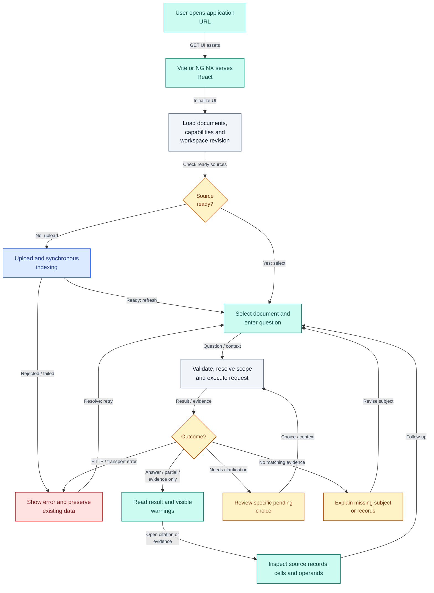
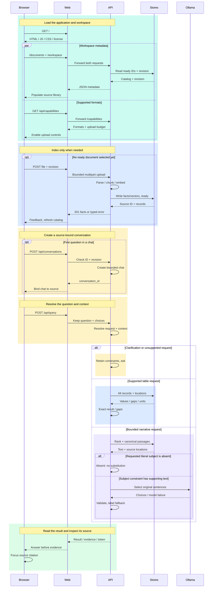
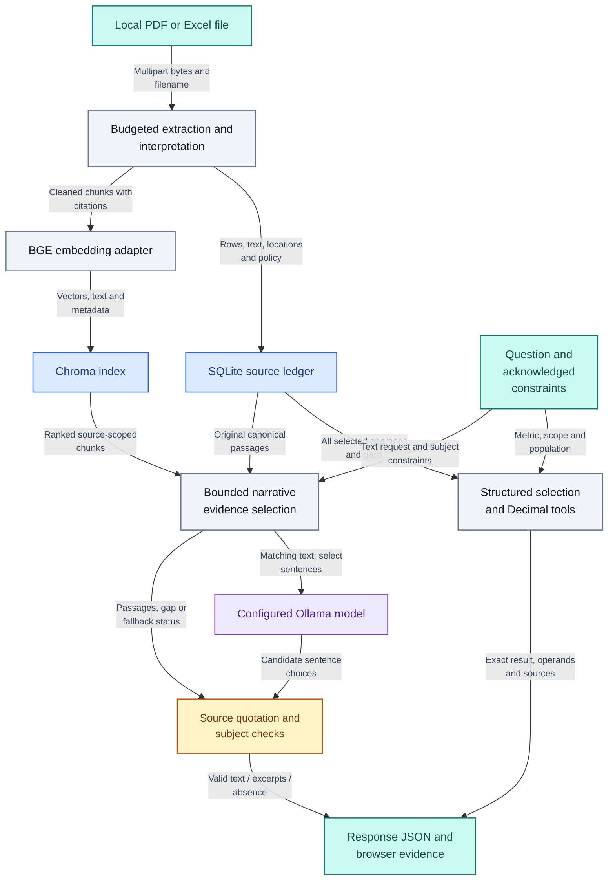
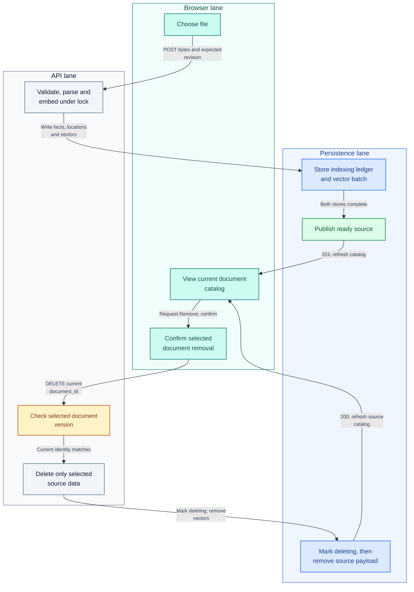

# Browser-to-answer journey — flow, sequence, data and responsibilities

Author: **Imitiyaz**. AI assistance: **AI Agent**. [Attribution](../AUTHORS.md).

These diagrams begin **after the operator has started the services** using [native setup](setup.md) or [Docker](docker.md). Typing a URL does not launch Python, Docker or Ollama. They explain an actual user's journey through this implementation, not a proposed autonomous-agent system.

## Browser-to-answer process flow

**Figure E2E-01 — From application URL to readable result and source inspection.**

The web layer is Vite on native port 5173 or NGINX on Compose port 8080. React first loads catalog, capability and workspace-revision metadata; it does not begin by sending a question to the model. Upload is optional when a ready source already exists. A normal HTTP response may contain an answer, a subtotal, a clarification, evidence-only fallback or no matching evidence; the UI renders those differences. A citation action opens evidence already supplied in that response instead of asking the model to reconstruct a source.

**Table JOURNEY-T01 — User-visible stages and implementation references.**

| Stage | What moves / what the user sees | Main implementation |
| --- | --- | --- |
| URL and application files | HTML, JavaScript, styles and legal/source link | `frontend/index.html`, Vite config or `deploy/nginx.conf` |
| Workspace initialization | Catalog, supported extensions, upload limit and workspace revision | `frontend/src/App.tsx`, `api.ts`, API catalog/capability/workspace routes |
| Optional upload | Bounded multipart bytes; indexed/ready feedback | Upload route, loader registry and `PipelineService.ingest` |
| Question and chat context | Selected document ID, question, acknowledged token and optional refinements | UI query method, schemas and `ConversationBook` |
| Evidence and execution | Complete table population or bounded narrative passages | Structured engine/store, retriever and grounded generation |
| Result inspection | Readable values, status/warnings, operands and source records | `AnswerContent.tsx`, `App.tsx`, response models/presenter |

See [pipeline diagrams](pipeline.md) for detailed ingestion and routing branches; [API](api.md) for exact request/response contracts.

## Browser-to-answer sequence

**Figure E2E-02 — URL load, optional indexing and a first or follow-up question.**

There are five participants. The stores represent two persistence adapters, not one shared transaction; BGE embedding runs in the API process. Narrative selection may call the separate host model, while structured values/calculations do not. The web layer removes the `/api` prefix before forwarding. Existing chats skip the conversation-creation step and acknowledge the latest accepted response token. Error responses and no-evidence results are outcomes, not invented factual answers. Runtime startup/readiness is documented separately from this browser journey.

## Data flow and retention

**Figure FLOW-01 — Evidence data from upload bytes to an inspectable answer.**

This is a logical data-flow view: edge labels name the data crossing a boundary. It is not a formal security certification. SQLite retains canonical extracted payloads and interpretation provenance; Chroma retains search chunks/vectors. The raw file is used for a digest and its temporary staging copy is removed after processing. The browser may hold recent answer/history content; process-local conversation constraints are distinct from persistent document data. Neither the vector index nor a model-generated sentence is an independently checked business truth. See [data semantics](data-model.md), [trust boundaries](../SECURITY.md) and [cleanup domains](cleanup.md).

## Swimlane responsibilities for indexing and removal

**Figure SWIM-01 — Browser, API and persistence responsibilities across a document lifecycle.**

The horizontal groups are responsibility lanes, not separate background workers. The browser requests an action and displays its outcome. The API validates identities, holds the process lock and orchestrates work. Persistence records whether a source is ready, indexing or deleting. The removal path uses the currently selected version; **New chat is not that path**. If a write/cleanup fails, compensation and startup reconciliation keep the affected source unavailable; there is no distributed transaction. The [state machine](data-model.md#document-state) shows those failure/recovery states, and [operations](operations.md#interrupted-indexingdeletion) explains recovery.

## Sequence caption details

The sequence uses short message captions to avoid forcing adjacent participants far apart. Browser means React and its API client; Web means Vite during native development or NGINX in Compose; API means the single FastAPI/service process; Stores means the SQLite/Chroma adapters; Ollama is the separate host model service. The grouping does not add a shared database transaction.

**Table JOURNEY-T06 — Full meaning of compact sequence captions.**

| Caption group | Full protocol meaning |
| --- | --- |
| Assets and library | GET / returns HTML, JavaScript, CSS and source/license assets. Concurrent metadata requests obtain ready document identities, workspace revision, supported formats and upload budget. |
| Upload | Multipart file and expected workspace revision are validated. Parsing, cleaning, chunking and local BGE embedding precede source-ledger/vector writes and ready publication. The result is a 201 source identity/count summary or typed error. |
| Bind chat | Conversation creation validates the selected document ID and workspace revision, creates bounded in-memory state and returns conversation_id. Existing chats skip creation. |
| Query and choices | The proxy forwards the exact question, acknowledged context and counting choice. The API validates identity and resolves pending constraints; clarification keeps the parts already understood. |
| Table records | Every selected record carries values, raw missing cells, units and original locations. Exact operations disclose incomplete populations and return their complete operands. |
| Narrative | Ranked chunks and canonical original passages remain bounded. Literal subject absence returns no_evidence without substitution. Otherwise the model selects original sentences; validation produces supported quotations, labeled fallback or honest empty evidence. |
| Response | Status, resolved question, evidence, warnings and next context token are returned. The UI presents a readable result before expandable details; activating a citation focuses its returned source reference. |
