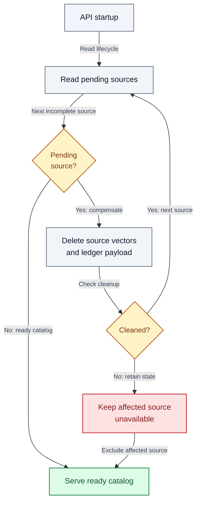

# Local operations and recovery

Author: **Imitiyaz**. AI assistance: **AI Agent**. [Attribution](../AUTHORS.md).

## Startup and health

Start Ollama, then the API and frontend using [setup](setup.md). The API loads its real embedding/index resources during application lifespan. `/health` reports process liveness; `/ready` reports initialized pipeline state. Neither endpoint verifies model answer quality.

Use one Uvicorn worker and an explicit loopback bind. Current service operations share one lock, so a long generation can delay other operations.

## Data locations

**Table OPS-T01 — Data locations.**

| Location | Contents |
| --- | --- |
| CHROMA_PERSIST_DIR | Persistent vector files and collection-scoped SQLite source ledger |
| UPLOAD_TEMP_DIR | Temporary uploads removed after processing |
| Hugging Face cache | Downloaded BGE model files |
| Ollama model store | Downloaded generation-model weights |
| reports / test-results / coverage | Generated verification artifacts; excluded from Git |

## Backup and restore

1. Stop the frontend and API; wait for API shutdown.
2. Copy the complete configured Chroma persistence directory, including its `<collection>-records.sqlite3` ledger, to an access-controlled backup location.
3. Record the application version, dependency resolution, embedding model/dimension, collection name and relevant configuration. Keep secret configuration separately secured.
4. Keep original uploaded files in their approved source system; the workspace is not an original-file archive.
5. Restore into a **different directory**, point `CHROMA_PERSIST_DIR` there and start one API worker.
6. Check the catalog, one exact lookup, a complete operand set and one narrative source. Do not delete the original workspace until recovery has been validated.

Do not copy only SQLite or only the vectors, and do not assume a live file copy is a consistent two-store snapshot.

## Interrupted indexing/deletion

**Figure OPS-01 — Startup reconciliation of incomplete document writes.**

Startup examines incomplete ledger states and attempts source-scoped cleanup. Successful cleanup rechecks the remaining sources; failed cleanup keeps that source unavailable while serving ready sources. Operators should inspect diagnostics rather than mark partial data ready manually.

Inspect errors and storage permissions. Retry source-scoped removal with a current identity or restart for reconciliation. Do not manually mark a partial document ready or delete random database files.

## Model and dependency changes

Use a separate environment and data directory for upgrades. Embedding changes can require a fresh index; source profile changes may require remove/re-upload. Preserve original data and a known dependency resolution until the new setup passes tests.

Direct Python pins improve repeatability but are not a complete transitive, hash-locked distribution. Capture `python -m pip freeze` and platform/model metadata during a release; keep sensitive host details out of public artifacts.

## Capacity measurement

Measure cold startup, model warm-up, ingestion, structured lookup/calculation and narrative requests separately. Include p50/p95 latency over a stated sample size and error/timeout counts. Vary document size, table width, selected population and context budget.

For RAM, identify the API PID/process tree and the separate Ollama server/model-runner processes. Report resident memory and peak timing consistently; do not call one process's sample “total application RAM.” GPU memory is a separate measure. Record hardware, model tag/digest, quantization, context length and concurrency.

Accept a capacity limit only after representative workloads and recovery tests. Synthetic file sizes and parser ceilings are not service-level guarantees.

## Generated artifacts and cleanup

Use [targeted cleanup](cleanup.md) to distinguish current chat, indexed documents, temporary uploads, test reports, backups and model caches. Reports/cache removal is not an index reset. Default application logging is console-based; retained logs/screenshots may contain document information. Docker volume deletion does not remove host Ollama weights, and document removal does not revoke external backup copies.

## Shutdown and incident response

Stop new uploads/questions, capture sanitized diagnostic evidence, stop the API, protect the affected workspace and preserve backups. Rotate any exposed credentials and assess copies/logs/endpoints separately. Restore a known source/environment plus a compatible workspace in isolation; verify before resuming.
