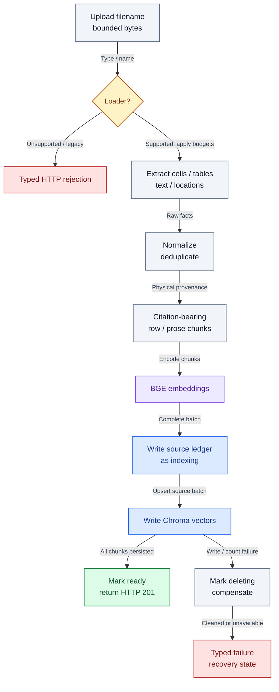
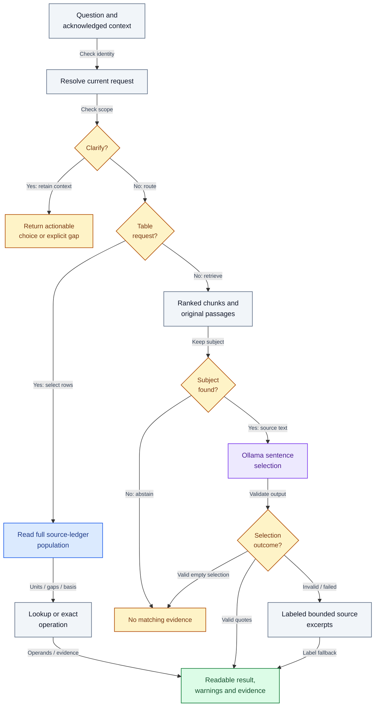

# Processing and answer flow

Author: **Imitiyaz**. AI assistance: **AI Agent**. [Attribution](../AUTHORS.md).

## Ingestion

**Figure PIPE-01 — Ingestion from bounded upload to ready document.**

Type dispatch and budgets precede extraction. Cleaned physical source identities flow into chunks and embeddings. Indexing is not ready until both stores are written; failures enter compensating deletion. This is lifecycle coordination, not a shared SQLite/Chroma transaction.

The loader registry discovers supported suffixes. XLSX/XLSM extraction preserves sheet names, Excel row/cell coordinates, physical values, merged anchors, formats and formula-cache diagnostics. Legacy XLS is rejected with conversion guidance. Formula expressions and workbook macros are not executed.

PDF extraction combines PyMuPDF text access and pdfplumber tables. Source locations are page names such as `page_1`, table-row identifiers such as `table_1_row_1` and text locations such as `full_page_text`. These are extraction locations, not bounding-box annotations or OCR verification.

Cleaning normalizes cells/text, removes qualifying repeated headers/footers and deduplicates table text where supported. Heuristics are tested against synthetic cases and can still misinterpret complex layouts.

Row chunks carry column labels and source identity. Wide rows may create several fragments; the ledger keeps the original complete physical row for structured operations. Prose chunking uses a text splitter while retaining page/location metadata.

## Query routing

**Figure PIPE-02 — Query routing, clarification and honest fallback.**

Acknowledged conversation/source checks happen before planning. Supported calculations select a full ledger population. Narrative requests pass through bounded retrieval, explicit-subject checks, model selection and original-sentence validation. Missing subjects abstain; invalid synthesis becomes labeled excerpts rather than an answered claim.

The narrative branch first constrains literal names/IDs and supported simple subject phrases to matching source text. It never treats Orchid as an alias for Rose. A model selecting no claims produces no evidence, rather than an answered card containing fallback excerpts. Invalid nonempty selections produce labeled excerpts from the constrained passages. This remains a bounded guard, not general entity linking or entailment.

The structured path supports recognized lookups, sums, extrema and comparisons. Unknown natural-language qualifiers may require clarification. Supplying schema-valid fields does not guarantee the intended business interpretation.

## Interpretation rules

Merged-cell values carry their physical anchor. Separately, the implemented `region-continuation-v1` policy can interpret an adjacent blank **Region** cell as a continuation when its conditions are met. This is an explicit domain assumption, not a universal spreadsheet rule. The original blank, original cell and inherited anchor remain in evidence.

Totals distinguish:

- **Complete selected total:** all selected numeric values are available under the chosen population.
- **Available-value subtotal:** known numeric values are summed and missing cells remain unknown.
- **No matching records:** no zero or fabricated contribution is inferred.
- **Ambiguous population:** overlapping/unknown cross-sheet populations require clarification.

Formatting uses original types/strings to preserve identifiers, signs, decimals and date literals. Calculation validation checks units and source associations; it does not perform currency conversion or invent missing values.

## Failure and recovery

Unsupported type, corrupt input, extraction budget, duplicate name and stale workspace errors have distinct codes. Temporary upload files are removed after the request. An indexing failure attempts source-scoped cleanup. If cleanup fails, the document remains unavailable and is reconsidered on startup.

The outer request body budget and file budget are distinct. Large bodies can fail before the parser is called. See [API](api.md) for statuses and [operations](operations.md) for recovery.
