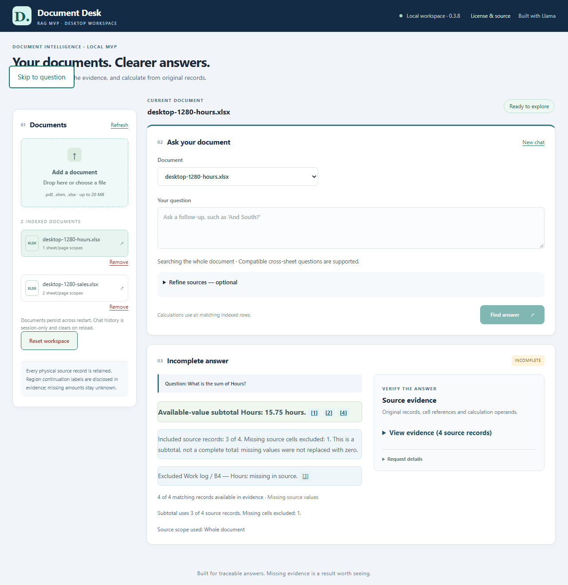

# Document Desk MVP — application walkthrough

Author: **Imitiyaz**. AI assistance: **AI Agent**. [Attribution](../AUTHORS.md).

## What the desktop workspace looks like

Choose a document in the library, ask a question in the main panel, then open the answer's source evidence. The images below are real application captures with synthetic documents. Their captions identify controlled versus actual-model execution; they are not universal accuracy or performance claims.

**Figure UI-01 — Desktop lookup with original-cell evidence expanded.**


North revenue of 45,000 with Q3 Sales row 2 and original cell B2. **Capture mode:** manual application capture. Application 0.3.8; image width 1467 pixels. Runtime configuration was not recorded.

**Figure UI-02 — Available-value subtotal with the missing source cell disclosed.**



Hours subtotal of 15.75 with missing B4 excluded and recorded zero retained. **Capture mode:** manual application capture. Application 0.3.8; image width 1449 pixels. Runtime configuration was not recorded.

## Read the answer and inspect its source

- The answer appears before detailed evidence. Status distinguishes answered, incomplete, no matching evidence and clarification.
- Open a source citation to inspect its row, cell or PDF location. Focus outlines can appear in keyboard-navigation captures.
- A subtotal warning identifies the missing source cells. It must remain visible with the result.
- **New chat** clears the conversation while keeping documents. **Remove** affects one selected document. **Reset workspace** is a separate confirmed action.

## Reproduce the screens

Use [native setup](setup.md) or [Docker deployment](docker.md), then follow the [browser smoke test](setup.md#8-verify-the-application-in-the-browser). For automated screenshots, use [the capture guide](screenshots.md). Raw captures stay in ignored reports; only reviewed images are copied into this gallery.

A caption marked **controlled browser capture** means the real UI/API/source records were exercised with explicit embedding/vector/model test adapters. It is not actual-model throughput evidence. An **actual-model application capture** uses the ordinary local services; structured calculations still do not call the model. Real-model behavior has its own [verification scope](validation.md).

A **manual application capture** is an operator-supplied screenshot reviewed for its displayed content. Its model and embedding configuration has not been verified, and its PNG width is not a recorded browser viewport. It illustrates the interface and source evidence without establishing model performance or automated capture success.

## Maintain the gallery

The [gallery manifest](assets/screenshots/gallery.json) records image mode, dimensions and hashes without raw questions/responses or machine paths. Run:

```powershell
python .\tools\ui_gallery.py --check
```

Review the images as well as the checks. A file hash proves identity, not content correctness or permission to publish.
